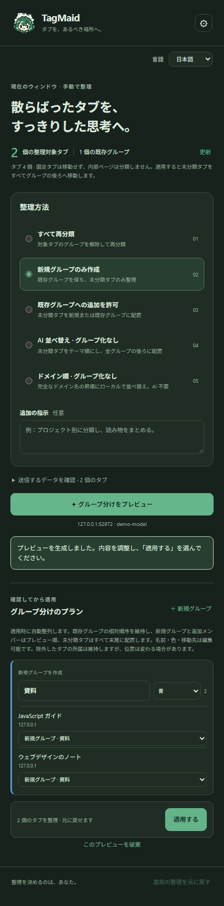

# TagMaid

<p align="center"></p>

**ブラウザーのタブを片づける、小さなメイド。** Google Chrome または Microsoft Edge のサイドバーで AI によるグループ分けや並べ替えをプレビューし、編集してから適用できます。自分の OpenAI 互換 API を使うほか、端末内だけでドメイン順に並べ替えることもできます。

[English](README.md) · [简体中文](README.zh-CN.md) · **日本語**

## スクリーンショット

実際の Chrome サイドバーを、ローカルのデモデータと空の API キーで撮影しています。プレビューはローカルの模擬 API で生成しています。

<p align="center"></p>

## インストールと使い方

1. [Releases](https://github.com/ikenainanodesu/tagmaid/releases) から `TagMaid-v1.1.1.zip` をダウンロードして展開するか、このリポジトリをクローンします。
2. Chrome は `chrome://extensions`、Edge は `edge://extensions` を開き、デベロッパー／開発者モードを有効にして「パッケージ化されていない拡張機能を読み込む／展開して読み込み」を選びます。
3. 展開した `TagMaid` フォルダーのうち、`manifest.json` を含むものを選びます。ソースから使う場合は `extension` を選びます。
4. ブラウザーの拡張機能メニューから TagMaid を固定し、ツールバーのアイコン、または **Alt+Shift+Y** でサイドバーを開きます。ショートカットは Chrome の `chrome://extensions/shortcuts`、Edge の `edge://extensions/shortcuts` で変更できます。
5. AI を使う場合は API URL、モデル名、キーを入力して保存し、API サイトへのアクセスを許可します。例は `https://api.example.com/v1` で、完全な `/chat/completions` URL も使えます。認証不要のローカルサービスではキーを空欄にできます。
6. モードと追加指示を選び、送信データを確認してプレビューを生成します。新規グループ名、色、移動先を編集したり、タブを除外したりしてから適用します。

利用に Node.js やビルドは不要です。ファイルの更新後は拡張機能の管理画面で再読み込みし、サイドバーを開き直してください。本リリースは展開して読み込む形式で、ブラウザーストア版ではありません。

最新のデスクトップ版 Chrome または Edge を使用してください。同じ拡張機能フォルダーで、五つのモードと三言語を利用できます。設定、API キー、復元記録は各ブラウザーのプロファイル内に個別に保存されます。ブラウザー検証は Windows で行い、macOS、Linux、モバイルは未検証です。

## 五つのモード

| モード | 動作 |
| --- | --- |
| すべて整理し直す | 既存グループ内を含む対象タブを再分類します。 |
| 新規グループのみ（既定） | 既存グループを保ち、未グループのタブだけ整理します。 |
| 既存グループへの追加を許可 | 未グループのタブを既存・新規グループへ追加し、既存の属性を保ちます。 |
| AI 並べ替え・グループ化なし | 未グループのタブをテーマや作業別に並べます。 |
| ドメイン順・グループ化なし | 完全なホスト名でローカル並べ替えを行い、同じホスト内の順序を保ちます。API は不要です。 |

対象はサイドバーのあるウィンドウだけです。固定タブは移動せず、HTTP(S) 以外のページは分類しません。

最初の3つのグループ化モードでは、適用後にウィンドウ全体を自動整列します。既存グループの相対順序を維持し、新規グループと各グループへの追加メンバーはプレビュー順に並べます。未分類タブは相対順序を保ち、すべてのグループの後ろへ移動します。内部ページ、除外タブ、プレビュー後に開いたタブの所属は変えませんが、配置は調整します。「元に戻す」でグループと適用直前の順序を復元できます。

グループ化しない2つの並べ替えモードでは、対象タブのみを既存グループより後ろの末尾へ移動します。既存グループのメンバー、名前、色、折りたたみ状態、相対順序は維持します。固定タブ、HTTP(S) 以外のページ、除外タブ、新しく開いたタブは対象外ですが、他のタブの移動により位置が変わる場合があります。

## 言語

**English・简体中文・日本語**に対応しています。初回はブラウザーの言語に従い、それ以外では英語になります。手動選択は端末内に保存されます。言語を切り替えてもプレビューと編集内容は残り、API を再呼び出ししません。AI の新規グループ名には生成開始時の言語を使い、追加指示で別の言語を明示した場合はその指示を優先します。ページタイトルや既存・編集済みグループ名は翻訳しません。ブラウザーが管理する拡張機能の文言は、別途ブラウザーの言語に従います。

## DeepSeek API

DeepSeek の公式 API（`api.deepseek.com`）を使用すると、インターフェースの外観が変化します。

## プライバシーとセキュリティ

- AI プレビューを生成するときだけ、設定した API に直接送信します。中継サーバー、テレメトリー、コンテンツスクリプト、ページ本文の収集、定期的な自動整理はありません。ドメイン順モードでは API 通信も API サイトの権限申請も行いません。
- 対象タブのタイトル、ID、処理済み URL と追加指示を送信します。URL のクエリ、フラグメント、ユーザー名、パスワードは除去します。**タイトル、ホスト名、パス、追加指示、グループ名には個人情報が残る場合があります。** 既存グループへ追加するモードではグループ名と対象メンバー情報も送信します。送信前に確認してください。
- キーは既定でブラウザーのセッションストレージに保存します。「この端末に保存」を選んだ場合だけローカルストレージへ保存し、クラウド同期はしません。この保存領域は暗号化された保管庫ではありません。チェックを外して保存すると永続キーを削除します。
- 公開 API は HTTPS が必須です。HTTP は `localhost` と `127.0.0.1` のみ許可します。リダイレクトを拒否し、90 秒でタイムアウトし、自動再試行はしません。非ストリーミングの Chat Completions に対応した API が必要です。
- 必須権限は `tabs`、`tabGroups`、`sidePanel`、`storage` です。サイトへのアクセスは任意権限で、ユーザー操作により設定先の API サイトへ申請します。インストール時に全サイトへのアクセスを取得するものではありません。
- モデル出力はデータとして解析・検証し、プレーンテキストで表示します。ブラウザー変更には確認が必要です。分類が不適切な場合もあるため、適用前に確認してください。

実装：[通信](extension/api.js)、[URL 処理と検証](extension/core.js)、[設定とプレビュー](extension/sidepanel.js)、[権限](extension/manifest.json)。報告方法と制約は [SECURITY.md](SECURITY.md) を参照してください。

## 元に戻す・復旧

各ウィンドウには現在のブラウザーセッション中、直前の操作を戻す記録を一つ保持します。同じウィンドウに残る対象タブだけを復元します。閉じたタブを開き直したり、別ウィンドウから戻したり、新たな固定を解除したり、新しいタブを閉じたりはしません。グループ ID は変わる場合があります。適用・復元中の手動操作は避けてください。

閉じたタブ、別ウィンドウへ移したタブ、新たに固定したタブはプレビューから除かれ、残りの編集は維持されます。新しいタブは次のプレビューで扱います。ページ遷移、手動グループ変更、対象グループの属性変更では、再生成または除外が必要になる場合があります。適用失敗時はロールバックを試み、中断した復旧はサイドバーから再試行できます。

## 開発

Node.js 22 以降を使います。Playwright は開発用で、拡張機能の実行時依存パッケージはありません。

```sh
npm ci
npm test
npm run check
npm run package
```

テストはモックのブラウザー API で URL 処理、応答検証、五つのモード、プレビュー変更、ロールバックと復元を検証します。静的チェックはマニフェスト、リソース、構文、UI 参照を確認します。パッケージ作成では生成ディレクトリ `dist/TagMaid` を置き換え、拡張機能と三言語の README を含むクリーンな内容にします。

Windows に現在のブラウザーをインストールし、`npm run test:chrome` と `npm run test:edge` を実行します。従来の `npm run test:language-browser` は Edge テストを実行します。`CHROME_PATH` または `EDGE_PATH` で実行ファイルを指定できます。独立したヘッドレスプロファイルで拡張機能のデバッグ API から一時コピーを読み込み、ツールバーのアクションを実行します。実際の `SIDE_PANEL` コンテキスト、五つのモード、適用後のタブ状態と復元、三言語、300/382px レイアウトをローカルの模擬 API で検証します。これらのデバッグコマンドを持たない旧バージョンでは実行できませんが、手動インストールの対応条件とは別です。

成果物は Git 対象外の `test-results/language-chrome-*` と `test-results/language-edge-*` に保存されます。模擬 API の権限を事前付与するのはテスト用コピーだけで、配布用は任意のサイト権限を維持します。実プロバイダーの分類品質、データ保持方針、ネイティブ権限ダイアログ、実際のマウスやショートカットキー操作は未検証です。

## ライセンス

Copyright © 2026 ikenainanodesu。TagMaid 独自のコード、文書、Logo、アイコン、アニメーション素材には **GNU GPL バージョン 3 のみ**（`GPL-3.0-only`）を適用します。全文は [LICENSE](LICENSE)、プロジェクトの通知は [NOTICE](NOTICE) を参照してください。第三者のコンポーネントはそれぞれのライセンスを保持します。配布パッケージには両ファイルを含め、[v1.1.1 に対応するソース](https://github.com/ikenainanodesu/tagmaid/tree/v1.1.1) を本リポジトリで提供します。

## フィードバック

不具合は [Issues](https://github.com/ikenainanodesu/tagmaid/issues)、アイデアや交流は [Discussions](https://github.com/ikenainanodesu/tagmaid/discussions) へ投稿できます。画像やログからキー、機密 URL、私的なタブタイトルを除いてください。
