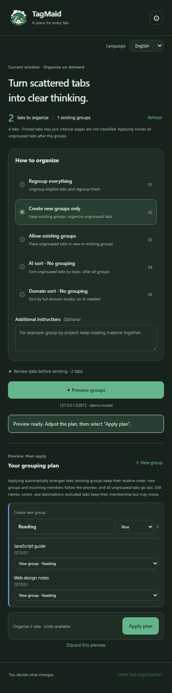
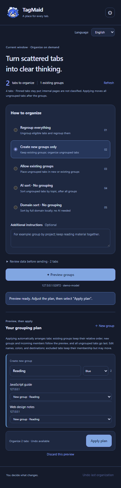

# TagMaid

<p align="center"></p>

**A little maid for your browser tabs.** Preview, edit, and confirm AI-powered tab groups or sorting in the Google Chrome or Microsoft Edge sidebar. Bring your own OpenAI-compatible API, or sort by domain entirely on your device.

**English** · [简体中文](README.zh-CN.md) · [日本語](README.ja.md)

## Screenshots

Actual Chrome sidebar with local demo data and an empty API key. Each image uses the same language as this guide. The blue appearance demonstrates the DeepSeek easter egg; the preview was generated by a local mock API.

| Default appearance | DeepSeek appearance |
| --- | --- |
|  |  |

## Install and use

1. Download and extract `TagMaid-v1.1.0.zip` from [Releases](https://github.com/ikenainanodesu/tagmaid/releases), or clone this repository.
2. In Chrome, open `chrome://extensions`; in Edge, open `edge://extensions`. Enable **Developer mode** and select **Load unpacked**.
3. Choose the extracted `TagMaid` folder containing `manifest.json`; for a source checkout, choose `extension`.
4. Pin TagMaid from the browser's extensions menu and click its toolbar icon, or press **Alt+Shift+Y**. Change conflicting shortcuts at `chrome://extensions/shortcuts` (Chrome) or `edge://extensions/shortcuts` (Edge).
5. For AI modes, enter your API URL, model name, and key, then save and authorize the API site. Example: `https://api.example.com/v1`; a full `/chat/completions` URL also works. A local service without authentication may use an empty key.
6. Choose a mode, optionally add instructions, review the outgoing data, and generate a preview. Edit new group names, colors, and assignments, or exclude tabs. Confirm to apply.

No Node.js installation or build is needed to use the extension. After updating its files, click **Reload** in the extension manager and reopen the sidebar. This release is an unpacked extension, not a browser-store installation.

Use an up-to-date desktop Chrome or Edge. Both browsers load the same extension folder and provide the same five modes and three languages. Settings, API keys, and undo records stay in each browser profile separately. Browser checks run on Windows; macOS, Linux, and mobile browsers have not been verified.

## Five modes

| Mode | Behavior |
| --- | --- |
| Reorganize all | Regroup eligible tabs, including those already in groups. |
| New groups only (default) | Preserve existing groups; organize only ungrouped tabs. |
| Allow existing groups | Let ungrouped tabs join existing or new groups; preserve existing group properties. |
| AI sort · no grouping | Sort ungrouped tabs by topic or task without creating groups. |
| Domain sort · no grouping | Sort locally by full hostname, retaining the original order within each hostname; no API needed. |

Only the sidebar's window is affected. Pinned tabs stay in place; non-HTTP(S) pages are not classified.

Applying any of the three grouping modes automatically arranges the whole window: existing groups keep their relative order, new groups follow preview order, and incoming members follow their preview order within each group. All ungrouped tabs retain their relative order and move after all groups. Internal pages, excluded tabs, and tabs opened after the preview retain their group membership but take part in this layout adjustment. Undo restores both groups and the order from immediately before applying.

The two sorting-only modes move only participating tabs to the window's end, after existing groups. Existing groups retain their members, names, colors, collapsed state, and relative order. Pinned, non-HTTP(S), excluded, and newly opened tabs do not participate in sorting-only modes, though positions may shift when other tabs move.

## Languages

The interface supports **English, 简体中文, and 日本語**. First use follows the browser language, falling back to English for other languages. Manual choices are stored locally. Switching preserves the preview and edits without another API request. AI group names use the language selected when generation starts, unless your instructions explicitly request another language. Page titles and existing or edited group names are not translated. Browser-managed extension text follows the browser language separately.

## DeepSeek easter egg

Saving an HTTPS API URL on `api.deepseek.com` unlocks a blue whale-maid theme: the sidebar logo, waiting animation and toolbar icon change together. Other providers restore the green theme; local domain sorting keeps the saved provider’s appearance. The installed extension icon stays unchanged.

## Privacy and security

- Only an explicit AI preview request sends data directly to your configured API. There is no relay server, telemetry, content script, page-body collection, or scheduled organization. Domain sorting makes no API request or API-site permission request.
- AI receives eligible tab titles, IDs, sanitized URLs, and your instructions. URL queries, fragments, usernames, and passwords are removed. **Titles, hostnames, paths, instructions, and group names can still contain private information.** The existing-groups mode also sends existing group names and eligible member metadata. Review the data before sending.
- Keys use browser-session storage by default. **Remember on this device** opts into local extension storage without cloud sync. This storage is not an encrypted vault. Uncheck and save to remove the persistent key.
- Public API endpoints require HTTPS; HTTP is allowed only for `localhost` and `127.0.0.1`. Requests reject redirects, time out after 90 seconds, and are not automatically retried. The API must support non-streaming Chat Completions.
- Required permissions are `tabs`, `tabGroups`, `sidePanel`, and `storage`. Website access is optional and requested for your configured API site through a user action, rather than granted for all sites at installation.
- Model output is parsed and validated as data, rendered as plain text, and requires confirmation before browser changes. Classification may still be wrong; inspect the preview.

Implementation: [network requests](extension/api.js), [URL cleanup and plan validation](extension/core.js), [settings and preview](extension/sidepanel.js), [permissions](extension/manifest.json). See [SECURITY.md](SECURITY.md) for reporting and boundaries.

## Undo and recovery

Each window keeps one undo record for the current browser session. Undo restores eligible tabs still in that window; it does not reopen closed tabs, retrieve tabs from other windows, unpin newly pinned tabs, or close new tabs. Group IDs may change. Avoid manual tab changes while applying or undoing.

Closed, moved, or newly pinned tabs are removed from previews while remaining edits are preserved. New tabs wait for the next preview. Navigation, regrouping, or changed target-group properties may require regeneration or exclusion. Application failures trigger rollback; interrupted recovery remains available in the sidebar.

## Development

Use Node.js 22 or newer. Playwright is development-only; the extension has no runtime package dependencies.

```sh
npm ci
npm test
npm run check
npm run package
```

Tests cover URL cleanup, response validation, five modes, preview changes, rollback, and undo with mock browser APIs. Static checks validate the manifest, resources, script syntax, and UI references. Packaging replaces the generated `dist/TagMaid` directory with a clean extension and all three READMEs.

On Windows, run `npm run test:chrome` and `npm run test:edge` with current installed browsers. `npm run test:language-browser` remains an alias for the Edge test. Set `CHROME_PATH` or `EDGE_PATH` for another executable. Each test starts an isolated headless browser profile, loads a temporary extension copy through the browser's extension debugging interface, and triggers the toolbar action. It verifies a real `SIDE_PANEL` context, all five modes, applied tab state and undo, three languages, and 300/382px layouts with a local mock API. Older browser versions without these debugging commands cannot run this test; this is separate from manual installation support.

Artifacts stay under ignored `test-results/language-chrome-*` and `test-results/language-edge-*`. Only the test copy grants access to the local mock API; the packaged extension retains optional site permissions. These checks do not establish real-provider classification quality, retention policies, native permission-dialog interaction, or physical toolbar/shortcut key input.

## License

Copyright © 2026 ikenainanodesu. TagMaid's original code, documentation, Logo, icons, and animation assets are licensed under **GNU GPL version 3 only** (`GPL-3.0-only`). See [LICENSE](LICENSE) for the full terms and [NOTICE](NOTICE) for the project notice. Third-party components retain their own licenses. The release package includes both files; [corresponding source for v1.1.0](https://github.com/ikenainanodesu/tagmaid/tree/v1.1.0) is available in this repository.

## Feedback

Use [Issues](https://github.com/ikenainanodesu/tagmaid/issues) for bugs and [Discussions](https://github.com/ikenainanodesu/tagmaid/discussions) for ideas and conversation. Remove keys, sensitive URLs, and private tab titles before posting screenshots or logs.
