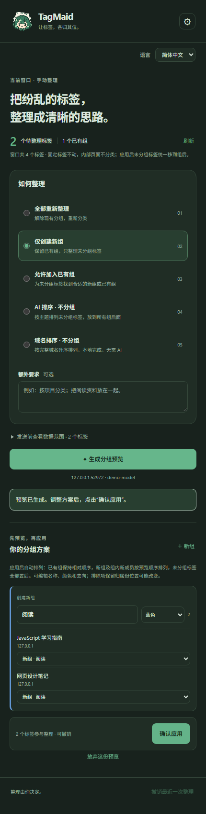

# TagMaid

<p align="center"></p>

**帮你整理浏览器标签的小女仆。** 在 Google Chrome 或 Microsoft Edge 侧栏中预览、编辑并确认 AI 分组或排序。连接自己的 OpenAI 兼容 API，也可以完全在本机按域名排序。

[English](README.md) · **简体中文** · [日本語](README.ja.md)

## 插件截图

以下为真实 Chrome 侧栏截图，使用本地演示数据、空 API 密钥，预览由本地模拟 API 生成。

<p align="center"></p>

## 安装与使用

1. 从 [Releases](https://github.com/ikenainanodesu/tagmaid/releases) 下载并解压 `TagMaid-v1.1.1.zip`，或克隆本仓库。
2. Chrome 打开 `chrome://extensions`，Edge 打开 `edge://extensions`，开启「开发者模式／开发人员模式」，点击「加载已解压的扩展程序／加载解压缩的扩展」。
3. 选择解压后包含 `manifest.json` 的 `TagMaid` 文件夹；使用源码时选择 `extension`。
4. 从浏览器扩展菜单固定 TagMaid 后点击工具栏图标，或按 **Alt+Shift+Y** 打开侧栏。快捷键可在 Chrome 的 `chrome://extensions/shortcuts` 或 Edge 的 `edge://extensions/shortcuts` 修改。
5. 使用 AI 时填写 API 地址、模型名称和密钥，保存并授权 API 站点。例如 `https://api.example.com/v1`，也可填写完整 `/chat/completions` 地址。本地免密服务可留空密钥。
6. 选择模式，可附加要求，检查发送数据后生成预览。编辑新组名称、颜色和标签去向，或排除标签，最后确认应用。

使用扩展不需要 Node.js 或构建。更新文件后，在扩展管理页点击「重新加载」并重新打开侧栏。本版本以解压扩展方式安装，未上架浏览器商店。

请使用保持更新的桌面 Chrome 或 Edge。两者加载同一个扩展目录，五种模式与三语界面一致；设置、API 密钥及撤销记录分别保存在各自浏览器配置中。浏览器验证在 Windows 上完成，macOS、Linux 和移动端尚未验证。

## 五种模式

| 模式 | 行为 |
| --- | --- |
| 全部重新整理 | 对符合条件的标签重新分组，包括已在组内的标签。 |
| 仅创建新组（默认） | 保留已有组，仅整理未分组标签。 |
| 允许加入已有组 | 未分组标签可加入已有组或新组，已有组属性保留。 |
| AI 排序 · 不分组 | 按主题或任务排列未分组标签，不创建分组。 |
| 域名排序 · 不分组 | 本地按完整域名排序，同域名保持原顺序，无需 API。 |

只操作侧栏所在窗口。固定标签保持不动，非 HTTP(S) 页面不参与分类。

前三种分组模式应用后会自动排列整个窗口：已有组保持相对顺序，新组按预览顺序排列，组内新成员按预览顺序排列；全部未分组标签保持原相对顺序并集中到所有组之后。内部页面、排除项和预览后新增标签保留分组归属，但会参与整体位置调整。撤销同时恢复分组和应用前的顺序。

两种纯排序模式只将参与排序的标签移至窗口末尾、已有组之后；已有组成员、名称、颜色、折叠状态及相对顺序保留。固定标签、非 HTTP(S) 页面、排除项和新增标签不参与纯排序，但绝对位置可能随其他标签移动而变化。

## 界面语言

支持 **English、简体中文、日本語**。首次跟随浏览器语言，其他语言回退英文；手动选择仅保存在本机。切换语言保留预览和编辑，不重新请求 API。AI 新组名默认使用开始生成时的语言，附加要求明确指定其他语言时优先遵从。网页标题、已有或已编辑的组名不翻译。浏览器管理的扩展文案另行跟随浏览器语言。

## DeepSeek API

使用 DeepSeek 官方 API（`api.deepseek.com`）时，界面会有变化。

## 隐私与安全

- 仅主动生成 AI 预览时，直接向你配置的 API 发送数据。没有转发服务器、统计上报、内容脚本、网页正文采集或后台定时整理。域名排序不调用 API，也不申请 API 站点权限。
- AI 接收候选标签标题、编号、处理后的网址及附加要求。查询参数、片段和嵌入的账号密码会移除。**标题、域名、路径、附加要求和组名仍可能含私人信息。** 允许加入已有组的模式还会发送已有组名及符合条件的组内标签信息。发送前请检查。
- 密钥默认只存于浏览器会话。勾选「在此设备记住密钥」才会写入扩展本地存储，不云同步；该存储不是加密保险箱。取消勾选并保存会移除持久密钥。
- 公网 API 必须使用 HTTPS；HTTP 仅允许 `localhost` 和 `127.0.0.1`。请求不跟随重定向，90 秒超时，不自动重试。接口需要支持非流式 Chat Completions。
- 必需权限为 `tabs`、`tabGroups`、`sidePanel` 和 `storage`。网站访问是可选权限，由用户操作时申请配置的 API 站点，并非安装时授予所有网站访问权限。
- 模型结果作为数据解析和校验，以纯文本显示，确认后才修改浏览器。分类仍可能不合理，应用前应检查预览。

实现依据：[网络请求](extension/api.js)、[网址清理与方案校验](extension/core.js)、[设置与预览](extension/sidepanel.js)、[权限](extension/manifest.json)。安全报告方式及边界见 [SECURITY.md](SECURITY.md)。

## 撤销与恢复

每个窗口在当前浏览器会话中保留一次撤销记录。撤销只恢复仍在原窗口且符合条件的标签，不重开关闭页面、不从其他窗口拉回、不解除后来固定的标签，也不关闭新增标签。分组 ID 可能变化。应用或撤销期间请避免手动改变标签。

关闭、移窗或后来固定的标签会从预览移除，其余编辑保留；新增标签留到下次预览。导航、手动改组或目标组属性变化时，可能需要重新生成或排除相关标签。应用失败会尝试回滚；未完成的恢复可在侧栏重试。

## 开发

使用 Node.js 22 或更新版本。Playwright 仅用于开发，扩展没有运行时包依赖。

```sh
npm ci
npm test
npm run check
npm run package
```

测试使用模拟浏览器 API 验证网址清理、响应校验、五种模式、预览变化、回滚和撤销。静态检查验证清单、资源、脚本语法和界面引用。打包会替换生成目录 `dist/TagMaid`，产出干净的扩展及三语 README。

Windows 安装当前版本的浏览器后，分别运行 `npm run test:chrome` 和 `npm run test:edge`。原命令 `npm run test:language-browser` 仍运行 Edge 测试。可用 `CHROME_PATH` 或 `EDGE_PATH` 指定程序路径。每次测试启动独立的无界面浏览器配置，通过浏览器扩展调试接口加载临时扩展副本并触发工具栏入口，确认真实 `SIDE_PANEL` 上下文，使用本地模拟 API 验证五种模式、应用后的标签状态与撤销、三语界面及 300/382px 布局。缺少这些调试命令的旧版浏览器无法运行此测试，这与手动安装兼容性是不同的要求。

产物保存在被忽略的 `test-results/language-chrome-*` 和 `test-results/language-edge-*`。仅测试副本预先授予本地模拟 API 权限，安装包仍使用可选站点权限。这些检查不代表真实供应商分类质量、数据留存政策、原生权限弹窗交互或实际鼠标点击工具栏／键盘快捷键已验证。

## 许可证

版权所有 © 2026 ikenainanodesu。TagMaid 的原创代码、文档、Logo、图标和动画素材统一采用 **GNU GPL 第 3 版，仅限该版本**（`GPL-3.0-only`）。完整条款见 [LICENSE](LICENSE)，项目授权声明见 [NOTICE](NOTICE)。第三方组件保留各自许可证。安装包包含这两个文件，[v1.1.1 对应源码](https://github.com/ikenainanodesu/tagmaid/tree/v1.1.1) 在本仓库提供。

## 反馈

在 [Issues](https://github.com/ikenainanodesu/tagmaid/issues) 报告问题，在 [Discussions](https://github.com/ikenainanodesu/tagmaid/discussions) 分享想法或交流。发布截图和日志前，请移除密钥、敏感网址与私人标签标题。
